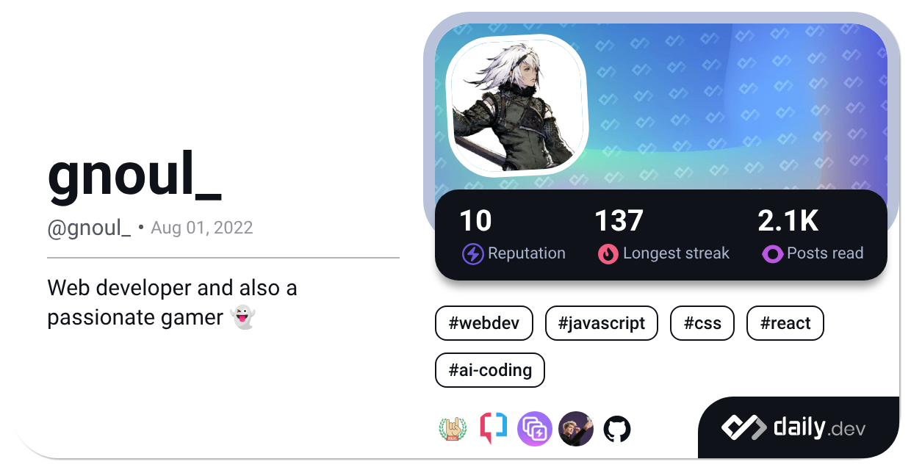

<p  align="center">
  <a href="https://app.daily.dev/gnoul_">
  
  </a>
</p>

## 👻 About

&ensp;👋 Hi, I’m @gnoul4869

&ensp; 👀 I’m interested in reading manga

&ensp; 🎸 I’m currently learning music

&ensp; 💬 Add me on Discord: <b>gnoul_</b>

## 🏆 Trophies
 <a href="https://github.com/gnoul4869">
   
 </a>
 
</br>
</br>

## ⚜ Stats

| <a href="https://github.com/gnoul4869"></a> | <a href="https://github.com/gnoul4869"></a> | 
| ------------- | ------------- |

<!--START_SECTION:waka-->


**I'm a Night 🦉** 

```text
🌞 Morning                969 commits         ⣿⣿⣀⣀⣀⣀⣀⣀⣀⣀⣀⣀⣀⣀⣀⣀⣀⣀⣀⣀⣀⣀⣀⣀⣀   09.66 % 
🌆 Daytime                2302 commits        ⣿⣿⣿⣿⣿⣿⣀⣀⣀⣀⣀⣀⣀⣀⣀⣀⣀⣀⣀⣀⣀⣀⣀⣀⣀   22.94 % 
🌃 Evening                3097 commits        ⣿⣿⣿⣿⣿⣿⣿⣿⣀⣀⣀⣀⣀⣀⣀⣀⣀⣀⣀⣀⣀⣀⣀⣀⣀   30.86 % 
🌙 Night                  3667 commits        ⣿⣿⣿⣿⣿⣿⣿⣿⣿⣀⣀⣀⣀⣀⣀⣀⣀⣀⣀⣀⣀⣀⣀⣀⣀   36.54 % 
```
📅 **I'm Most Productive on Sunday** 

```text
Monday                   1558 commits        ⣿⣿⣿⣿⣀⣀⣀⣀⣀⣀⣀⣀⣀⣀⣀⣀⣀⣀⣀⣀⣀⣀⣀⣀⣀   15.53 % 
Tuesday                  1446 commits        ⣿⣿⣿⣿⣀⣀⣀⣀⣀⣀⣀⣀⣀⣀⣀⣀⣀⣀⣀⣀⣀⣀⣀⣀⣀   14.41 % 
Wednesday                1376 commits        ⣿⣿⣿⣀⣀⣀⣀⣀⣀⣀⣀⣀⣀⣀⣀⣀⣀⣀⣀⣀⣀⣀⣀⣀⣀   13.71 % 
Thursday                 1491 commits        ⣿⣿⣿⣿⣀⣀⣀⣀⣀⣀⣀⣀⣀⣀⣀⣀⣀⣀⣀⣀⣀⣀⣀⣀⣀   14.86 % 
Friday                   1391 commits        ⣿⣿⣿⣀⣀⣀⣀⣀⣀⣀⣀⣀⣀⣀⣀⣀⣀⣀⣀⣀⣀⣀⣀⣀⣀   13.86 % 
Saturday                 1199 commits        ⣿⣿⣿⣀⣀⣀⣀⣀⣀⣀⣀⣀⣀⣀⣀⣀⣀⣀⣀⣀⣀⣀⣀⣀⣀   11.95 % 
Sunday                   1574 commits        ⣿⣿⣿⣿⣀⣀⣀⣀⣀⣀⣀⣀⣀⣀⣀⣀⣀⣀⣀⣀⣀⣀⣀⣀⣀   15.69 % 
```


🤖 **AI Coding This Week** 

```text
⏱ AI Coding Time: 7 hrs 15 mins (81.81%)

✍️ 235 lines written by AI, 46 lines written by hand (83.63% AI-written)

🔤 1,645,686 Input Tokens, 173,838 Output Tokens

💵 $26.73 Estimated AI Cost This Week

🧠 12 AI Sessions, 36 AI Prompts

Code                     0 lines             ⣀⣀⣀⣀⣀⣀⣀⣀⣀⣀⣀⣀⣀⣀⣀⣀⣀⣀⣀⣀⣀⣀⣀⣀⣀   00.00 % 

🔎 AI Coding Insights:
🤖 AI-Driven — 83.63% of written lines came from AI
📄 Detailed Prompter — average 653 characters per prompt
🔁 Iterative Prompter — average 3 prompts per session
🚀 High AI Trust — 16.67% of changed lines were hand-edited
```

**I Mostly Code in JavaScript** 

```text
JavaScript               18 repos            ⣿⣿⣿⣿⣿⣿⣿⣀⣀⣀⣀⣀⣀⣀⣀⣀⣀⣀⣀⣀⣀⣀⣀⣀⣀   26.87 % 
Python                   13 repos            ⣿⣿⣿⣿⣿⣀⣀⣀⣀⣀⣀⣀⣀⣀⣀⣀⣀⣀⣀⣀⣀⣀⣀⣀⣀   19.40 % 
Vue                      10 repos            ⣿⣿⣿⣿⣀⣀⣀⣀⣀⣀⣀⣀⣀⣀⣀⣀⣀⣀⣀⣀⣀⣀⣀⣀⣀   14.93 % 
TypeScript               4 repos             ⣿⣀⣀⣀⣀⣀⣀⣀⣀⣀⣀⣀⣀⣀⣀⣀⣀⣀⣀⣀⣀⣀⣀⣀⣀   05.97 % 
C++                      1 repo              ⣀⣀⣀⣀⣀⣀⣀⣀⣀⣀⣀⣀⣀⣀⣀⣀⣀⣀⣀⣀⣀⣀⣀⣀⣀   01.49 % 
```


<!--END_SECTION:waka-->

## 💾 Projects:
<pre>
J.A.D.A.I (10/2022 - Present):

J.A.D.A.I (Just Another Discord Artificial Intelligence) is an AI Assistant built to assist people 
on discord with many built-in functionalities.

Languages: Python
Libraries: Discord.py

-> <a href="https://top.gg/bot/847489154715222026">J.A.D.A.I</a>
</pre>

<pre>
Gunny 3.0G (11/2023 - Present):

Gunny 3.0G is a Gunny 3.0 restoration project, fixing/reworking a buggy, community-shared version of the 
classic web-based game, Gunny version 3.0. Many major and minor functionalities were non-functional prior 
to the fix, but the game is now fully functional and playable.

Languages: C#, ActionScript
Framework: ASP.NET
Database: Microsoft SQL Server

-> <a href="https://imgur.com/gallery/gunny-3-0g-ND0kX5C">Gunny 3.0G</a>
</pre>
